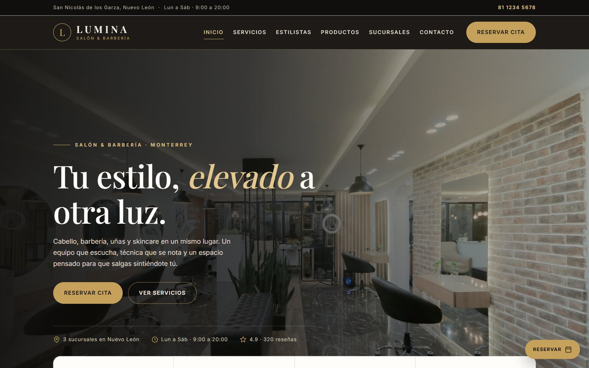
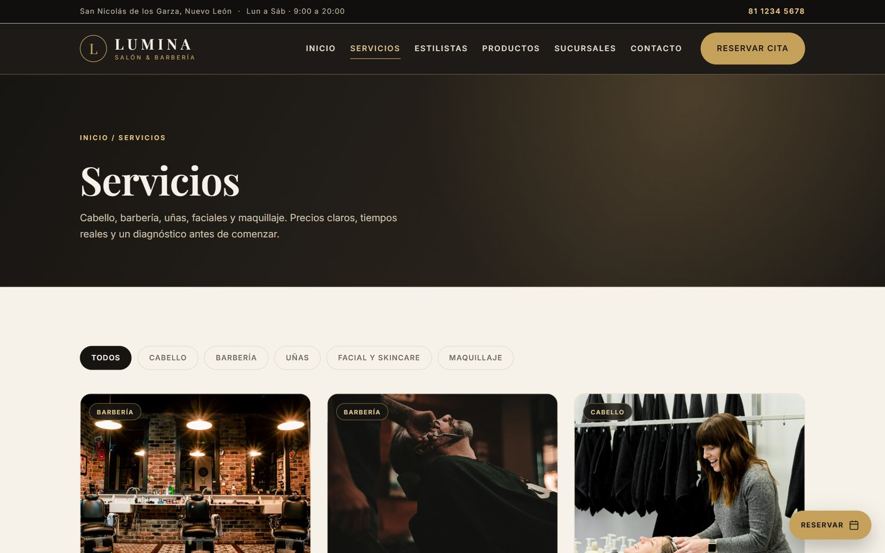
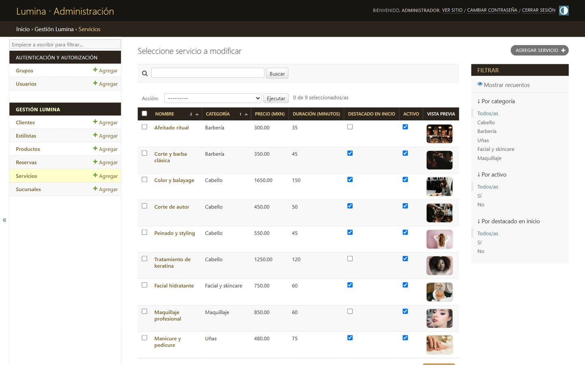
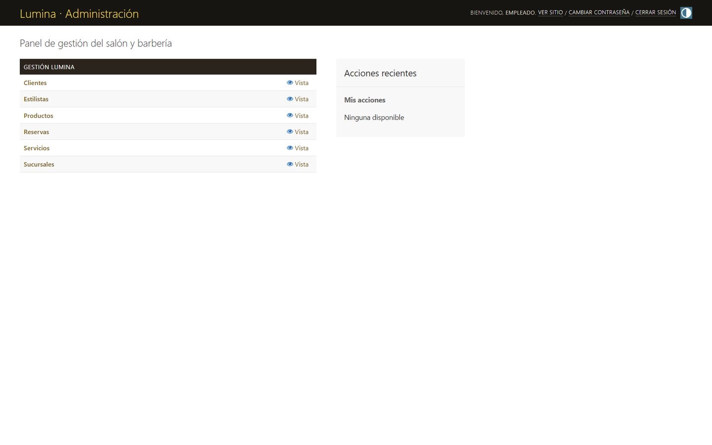

# Lumina — Salón & Barbería

**Sitio web y panel administrativo para un salón de belleza moderno.**<br>
Django · SQLite · RBAC · Diseño responsive

[](https://www.djangoproject.com/)
[](https://www.python.org/)
[](https://github.com/VeraAlejandro/lumina-salon-barberia/actions/workflows/ci.yml)
[](https://www.uanl.mx/)



## Descripción

Lumina es un proyecto académico desarrollado para el **Producto Integrador de Aprendizaje (PIA)** de *Fundamentos de Desarrollo Web* de la Facultad de Contaduría Pública y Administración de la UANL.

El proyecto resuelve una necesidad real de negocio: digitalizar la presencia de un salón y barbería, permitir reservas en línea y centralizar la operación diaria en un panel administrativo con permisos diferenciados.

Incluye un sitio público de siete páginas, administración con CRUD para seis entidades y un esquema de control de acceso basado en roles (RBAC) para tres tipos de usuario.

## Capturas

<table>
  <tr>
    <td width="50%">
      
      <br><sub><strong>Inicio</strong> — hero, servicios destacados y sucursales.</sub>
    </td>
    <td width="50%">
      
      <br><sub><strong>Servicios</strong> — catálogo con filtros por categoría.</sub>
    </td>
  </tr>
  <tr>
    <td width="50%">
      
      <br><sub><strong>Administración</strong> — CRUD y filtros de servicios.</sub>
    </td>
    <td width="50%">
      
      <br><sub><strong>RBAC</strong> — el rol Empleado solo puede consultar.</sub>
    </td>
  </tr>
</table>

## Características principales

- **Sitio público completo:** inicio, servicios, estilistas, productos, sucursales, reservas y contacto.
- **Formulario de reservas:** validación de fecha, sucursal, estilista y datos de contacto.
- **Panel administrativo:** CRUD para `Sucursal`, `Servicio`, `Estilista`, `Producto`, `Cliente` y `Reserva`.
- **Auditoría:** todos los modelos registran fecha de creación y de última actualización.
- **RBAC con tres roles:** Administrador (acceso total), Supervisor (solo alta) y Empleado (solo consulta).
- **Comandos idempotentes:** `seed_data` y `setup_rbac` se pueden ejecutar varias veces sin duplicar información.
- **Verificación automatizada:** suite de 15 pruebas y comando `verificar_rbac`.
- **Diseño responsive:** tipografías locales, imágenes optimizadas y panel con identidad visual propia.
- **Integración continua:** GitHub Actions ejecuta checks, migraciones y pruebas en cada push.

## Stack tecnológico

| Área | Tecnología |
|---|---|
| Backend | Python 3.12+ · Django 5.2 |
| Base de datos | SQLite (entorno de desarrollo) |
| Frontend | HTML5 · CSS3 · JavaScript · plantillas de Django |
| Imágenes | Pillow |
| Pruebas | `unittest` / `TestCase` de Django |
| CI | GitHub Actions |
| Herramientas de documentación | Playwright · python-docx (solo desarrollo) |

## Puesta en marcha

### Requisitos

- Python 3.12 o superior (probado con Python 3.14.7 en Windows 11)
- pip
- Navegador moderno

### Instalación

```powershell
git clone https://github.com/VeraAlejandro/lumina-salon-barberia.git
cd lumina-salon-barberia

python -m venv .venv
.\.venv\Scripts\Activate.ps1

pip install -r requirements.txt

python manage.py migrate
python manage.py seed_data
python manage.py setup_rbac
python manage.py runserver
```

En macOS o Linux, activa el entorno con `source .venv/bin/activate`.

Abre <http://127.0.0.1:8000/> para el sitio público y <http://127.0.0.1:8000/admin/> para el panel administrativo.

> La base de datos `db.sqlite3` no se versiona: se genera localmente con `migrate`, `seed_data` y `setup_rbac`. Las imágenes de demostración sí están incluidas en `media/`.

### Usuarios de prueba

| Usuario | Contraseña | Rol | Permisos |
|---|---|---|---|
| `admin` | `123` | Administrador | Superusuario: alta, consulta, edición y eliminación de todos los modelos, además de usuarios y grupos. |
| `supervisor` | `123` | Supervisor | Solo alta (`add`) de los seis modelos. No puede consultar listados, editar ni eliminar. |
| `empleado` | `123` | Empleado | Solo consulta (`view`) de los seis modelos. No puede crear, editar ni eliminar. |

Las credenciales y `DEBUG = True` son deliberadamente simples porque se trata de una entrega académica. Para un despliegue real se deben usar variables de entorno, contraseñas robustas, HTTPS y `DEBUG = False`.

## Configuración por variables de entorno

La configuración de desarrollo funciona sin variables adicionales. Para producción o para probar otro entorno:

| Variable | Valor por defecto | Descripción |
|---|---|---|
| `DJANGO_SECRET_KEY` | Clave de desarrollo | Clave secreta de Django. En producción debe ser larga y aleatoria. |
| `DJANGO_DEBUG` | `True` | Activa o desactiva el modo de depuración. |
| `DJANGO_ALLOWED_HOSTS` | `localhost,127.0.0.1,[::1]` | Lista de hosts permitidos, separada por comas. |

Ejemplo en PowerShell:

```powershell
$env:DJANGO_SECRET_KEY = "una-clave-larga-y-aleatoria"
$env:DJANGO_DEBUG = "False"
$env:DJANGO_ALLOWED_HOSTS = "midominio.com,www.midominio.com"
python manage.py runserver
```

## Pruebas y calidad

```powershell
python manage.py test
python manage.py check
python manage.py makemigrations --check --dry-run
python manage.py verificar_rbac
```

La suite cubre el sitio público, el formulario de reservas, la validación de fechas y la matriz de permisos RBAC (15 pruebas). El flujo de integración continua está definido en `.github/workflows/ci.yml`.

## Estructura del proyecto

```text
lumina-salon-barberia/
├── manage.py
├── requirements.txt
├── requirements-dev.txt
├── README.md
├── .github/workflows/ci.yml
├── salon/                    Configuración de Django
├── web/
│   ├── admin.py              Panel administrativo y redirección del supervisor
│   ├── forms.py              Formulario público de reserva
│   ├── models.py             Seis modelos con auditoría
│   ├── views.py              Vistas públicas
│   ├── tests.py              15 pruebas
│   ├── migrations/
│   ├── management/commands/  seed_data, setup_rbac, verificar_rbac
│   ├── static/               CSS, tipografías, imágenes y estilos del admin
│   └── templates/            Plantillas públicas y del panel
├── media/                    Imágenes de servicios, estilistas, productos y sucursales
├── capturas/                 Evidencia PNG del sitio y del panel
├── docs/
│   ├── PIA_Lumina.docx       Documento entregable editable
│   ├── PIA_Lumina.pdf        Versión PDF del documento
│   └── assets/               Logos institucionales, capturas del README y créditos
└── scripts/                  Generación del documento y capturas (opcional)
```

## Documentación

- [Documento del PIA (PDF)](docs/PIA_Lumina.pdf)
- [Documento del PIA (Word)](docs/PIA_Lumina.docx)
- [Créditos y procedencia de las imágenes](docs/assets/CREDITOS_IMAGENES.md)
- [Evidencia visual del sitio y del panel](capturas/)

El documento incluye portada institucional, índice, requisitos funcionales y no funcionales, oportunidad de negocio, matriz RBAC, manual de usuario con CRUD para los seis modelos, conclusiones, referencias y anexos.

Los scripts de `scripts/` permiten regenerar el documento y las capturas. Requieren `requirements-dev.txt` y, para actualizar el índice y exportar el PDF, Microsoft Word instalado:

```powershell
pip install -r requirements-dev.txt
python scripts/generar_documento.py
python scripts/actualizar_indice.py
```

## Autor

**Diego Alejandro Vera Reyes**<br>
Facultad de Contaduría Pública y Administración, Universidad Autónoma de Nuevo León<br>
GitHub: [@VeraAlejandro](https://github.com/VeraAlejandro)

## Licencia y uso

Este repositorio se publica con fines académicos y de portafolio. El código y los contenidos son © 2026 Diego Alejandro Vera Reyes. **Todos los derechos reservados**; no se concede permiso de reutilización sin autorización.

Las fotografías del sitio provienen de Unsplash y se usan conforme a su licencia. Los logotipos de la UANL y la FACPYA pertenecen a sus instituciones y se emplean únicamente en la portada académica del documento. Consulta [CREDITOS_IMAGENES.md](docs/assets/CREDITOS_IMAGENES.md) para el detalle por archivo.
